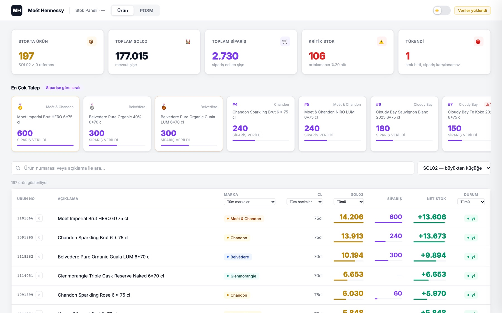
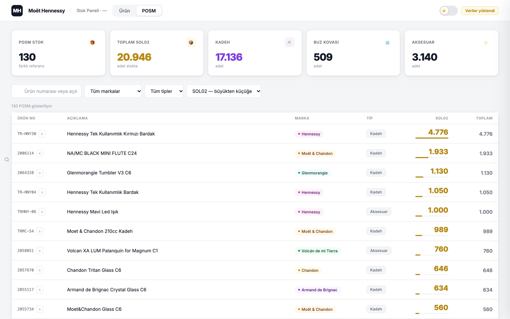
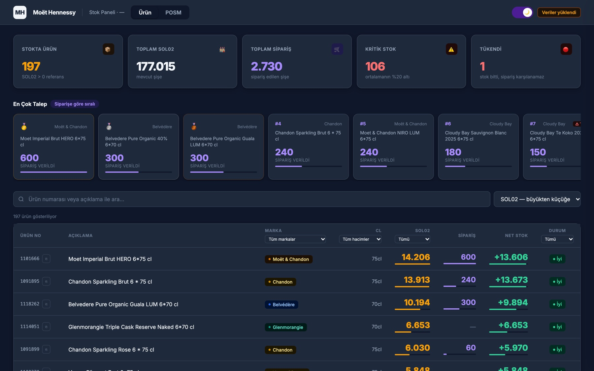
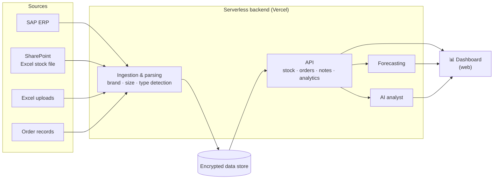

<h1 align="center">MH Dashboard</h1>

  <b>Stock, order and sales intelligence for a luxury drinks distributor.</b> 
  A web dashboard built for Moët Hennessy Türkiye that brings data from SAP, Excel files and order records into one place, follows orders automatically, and uses forecasting and AI to support decisions.

  
  
  
  

> **Note:** this dashboard is an internal company tool, so its source code and live data are private. This repository presents the project. A detailed technical overview is available as a PDF: **[docs/mh-dashboard-overview.pdf](docs/mh-dashboard-overview.pdf)**.

---

## Screenshots

  

<i>Products: key indicators, most-ordered products and the full stock table with filters.</i>

  
  

<i>Point-of-sale materials (glasses, ice buckets, displays…) and dark mode.</i>

---

## The problem

A drinks distributor manages hundreds of products (champagnes, cognacs, whiskies, wines) and thousands of point-of-sale materials (POSM) across many brands. The data lives in different places: the **SAP** ERP, **Excel exports** shared on SharePoint, and **order** files. Answering simple questions (*“Which products are about to run out?”, “What sells best this month?”, “How much should we order?”*) meant opening several files and doing the work by hand.

## The solution

MH Dashboard gathers all these sources automatically and turns them into one live view:

1. **Collect**: data is pulled automatically from SAP, the shared Excel files and the order records.
2. **Understand**: every line is cleaned and classified (brand, bottle size, product or POSM, material type).
3. **Decide**: key indicators, best and worst sellers, critical stock alerts, order tracking, sales forecasts and an AI analyst that answers questions about the data.

---

## Features

### Data integration
| Feature | Details |
|---|---|
| **SAP integration** | Stock and movement data from the company ERP |
| **Automatic Excel sync** | The shared stock file on SharePoint is fetched and parsed automatically (cached and refreshed every 15 minutes) |
| **Excel import** | Upload any full stock export (`.xlsx`); it is parsed and merged on the server |
| **Smart classification** | Detects the brand (25+ brands: Moët & Chandon, Dom Pérignon, Veuve Clicquot, Krug, Ruinart, Hennessy, Glenmorangie, Ardbeg, Belvédère…) from product codes and descriptions, extracts the bottle size, and separates products from POSM |

### Stock and orders
| Feature | Details |
|---|---|
| **KPI cards** | Products in stock, total bottles, total ordered, critical stock, out of stock |
| **Critical stock alerts** | Items below 20% of the average level, and items that can no longer cover orders |
| **Automatic order tracking** | Orders are followed from creation to delivery, with their effect on net stock |
| **Net stock** | Stock minus open orders, for each product |
| **Search and filters** | By reference, description, brand, bottle size, stock level and status |
| **POSM view** | Glasses, ice buckets, trays, displays and bar tools, grouped by type and brand |

### Analytics and AI
| Feature | Details |
|---|---|
| **Best and worst sellers** | Ranking of the most and least ordered products, by brand and period |
| **Sales forecasting** | Predicted demand per product, to plan orders before stock runs out |
| **AI analyst** | Ask questions about the data in plain language and get summaries and recommendations |

### Usability
| Feature | Details |
|---|---|
| **Notes** | Notes and photos attached to a product, shared with the team |
| **Light and dark mode** | |
| **Access control** | Password-protected access; stock data stored encrypted (AES-256) |
| **Usage analytics** | Visit tracking to see how the team uses the tool |

---

## Architecture

## Tech stack

| Layer | Technologies |
|---|---|
| Frontend | HTML, CSS, vanilla JavaScript (single-page app, no framework) |
| Backend | Node.js serverless functions on Vercel |
| Data | SAP, Excel (`xlsx` parsing), SharePoint, encrypted JSON store versioned with Git |
| Analytics | Demand forecasting, AI analysis |

---

## Impact

- One place instead of several Excel files: the team sees stock, orders and alerts **in seconds**.
- Problems are visible **before** they happen: critical stock and products that cannot cover their orders are flagged automatically.
- Used in production by the stock and sales team.

## What I learned

- **Data integration**: bringing messy data from an ERP, spreadsheets and manual files into one clean model
- **Data cleaning and classification** with rules built from real product codes
- Building a **production tool for real users** inside a company, and iterating with their feedback
- **Serverless architecture** with caching, conflict handling on concurrent updates and encrypted storage
- Turning data into **decisions**: KPIs, alerts, forecasting and AI summaries

---

  Designed and built by <b>Görkem Özbek</b>

